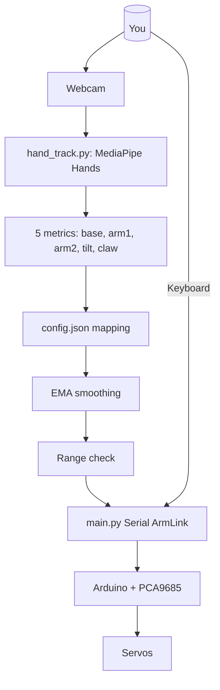

# Gesture-Controlled Arm Suite

<video width="100%" controls>
  <source src="./Media/demonstration.mp4">
  Demonstration Video
</video>

> **Three projects. Same 5-DOF arm. Different ways to command it.**
>
> Whether you wear colored markers, track your bare hand, or wave a red card,
> all three projects drive the same 3D-printable desktop arm using the same
> Arduino + PCA9685 hardware and the same serial protocol.

---

## Table of Contents

- [Quick Comparison](#quick-comparison)
- [Common Architecture](#common-architecture)
- [Project 1: Color-Vision Gesture Arm](#project-1-color-vision-gesture-arm)
- [Project 2: MediaPipe MeArm](#project-2-mediapipe-mearm)
- [Project 3: Red-Dot Object Tracker](#project-3-red-dot-object-tracker)
- [Which Project Should I Use?](#which-project-should-i-use)
- [Hardware Setup (Shared)](#hardware-setup-shared)
- [Project Layout](#project-layout)

---

## Quick Comparison

| | Project 1 | Project 2 | Project 3 |
|---|---|---|---|
| **Folder** | `Gesture-Controlled-5-DOF-Robotic-Arm-using-Computer-Vision/` | `Gesture-Controlled-MeArm/` | `Object-Detection/` |
| **Tracking** | OpenCV color-marker blobs | MediaPipe HandLandmarker (bare hand) | OpenCV red card + dark dot |
| **Markers needed?** | 3 colored blocks on your arm | None — your bare hand | Red square card with a dark dot |
| **Camera** | Webcam (built-in OK) | Webcam (built-in OK) | Webcam (built-in OK) |
| **Dependencies** | opencv, imutils, pyserial, numpy | opencv, mediapipe, pyserial, numpy | opencv, imutils, pyserial, numpy |
| **Model download** | — none | `hand_landmarker.task` (~5 MB) | — none |
| **Calibration** | HSV trackbars or auto-HSV | Hand size + pinch ranges in config.json | `train_red.py` from hex colors |
| **Tests** | `test_serial.py`, `probe_channels.py` | 5 unit-test suites | Vision-only mode (`--no-arm`) |
| **Difficulty** | Medium | Easy | Easy |

## Common Architecture

All three projects share the same hardware platform and the same serial wire
protocol. Only the **sensing** layer on the Python host differs.

```
                +-------------------------------------------+
                |       Host Computer (Python)              |
                |                                           |
   Project      |  +----------------+     +-------------+   |
   1 (color) +--+>  OpenCV         +--->  | Color blobs |   |
                |  | blob tracking   |    |  pose->5    |   |
                |  +----------------+     |  angles      |   |
                |                        +------+-------+   |
                |                               |            |
   Project      |  +----------------+     +------v-------+   |
   2 (MediaPipe) +-->  MediaPipe      +---> | Hand landmarks |  |
                |  | HandLandmarker |    |  -->5 metrics  |   |
                |  +----------------+     +------+-------+   |
                |                               |            |
   Project      |  +----------------+     +------v-------+   |
   3 (red dot) +-->  OpenCV         +--->  | Red card+dot  |   |
                |  | blob detection  |    |  centroid     |   |
                |  +----------------+     +------+-------+   |
                |                               |            |
                |          5 angles + 0xAA frame            |
                +-------------------------------+-----------+
                                                | Serial
                                                v
                +-------------------------------------------+
                |  Arduino Uno + PCA9685 (I2C, 60 Hz)       |
                |  Ch0: Base rotation                        |
                |  Ch1: Shoulder (arm1)                      |
                |  Ch2: Elbow (arm2)                         |
                |  Ch4: Wrist tilt                         |
                |  Ch5: Claw gripper                       |
                +-------------------------------------------+
```

### Serial Protocol (Shared)

Every packet is 6 bytes, sent only when angles change:

```
+------+------+------+------+------+------+
| 0xAA | arm1 | arm2 | tilt | base | claw |
| sync | 0-180| 0-180| 0-180| 0-180| 0-180|
+------+------+------+------+------+------+
  struct.pack(">BBBBBB", 0xAA, arm1, arm2, tilt, base, claw)

Firmware clamps, drives PCA9685, replies:
ACK A1=72 A2=74 T=60 B=90 C=10
```

### PCA9685 Channel Map

| Joint | Channel | Safe range |
|-------|---------|------------|
| Base rotation | 0 | 30 - 150 deg |
| Shoulder (arm1) | 1 | 40 - 140 deg |
| Elbow (arm2) | 2 | 40 - 140 deg |
| Wrist tilt | 4 | 40 - 140 deg |
| Claw gripper | 5 | 30 - 90 deg |

Channel 3 unused. Firmware hard-codes limits.

## Project 1: Color-Vision Gesture Arm

> **Use this when:** you want the most direct "wear markers on your arm"
> experience and don't mind attaching the three colored blocks to your arm.

This is the original project (forked from Jingzhou Liu's work) — the host PC
tracks three colored markers (yellow tricep, red elbow, green wrist) with
OpenCV, computes shoulder/elbow/wrist angles from the marker vectors, and
streams them to the Arduino.

### Data Flow

```
Webcam frame
  |
  +-> Gaussian blur + HSV conversion
  +-> Three color masks (green / red / yellow)
         - Face Haar cascade blanks face regions from every mask
         - erode + dilate to denoise
  +-> marker_center() on each mask
         - findContours -> best_marker() (area + circularity filter)
         - minEnclosingCircle + contour moments -> centroid
  +-> Vector math
         - Arm1_Vector = red_center - yellow_center -> shoulder angle
         - Arm2_Vector = red_center - green_center -> elbow angle
  +-> Wrist tilt solver (keeps gripper level)
         tilt = -(180 - alpha - beta) + 60
  +-> EMA smoothing (alpha = 0.4) removes jitter
  +-> Serial write: 0xAA + arm1, arm2, tilt, base, claw
```

### Startup Guide

```bash
cd Gesture-Controlled-5-DOF-Robotic-Arm-using-Computer-Vision

# 1. Virtual environment (macOS / Linux)
python3 -m venv venv
source venv/bin/activate
pip install -r requirements.txt

# 2. Flash the Arduino firmware
#    Open Gesture_Controlled_Robotic_Arm_Arduino_Code/
#    ...Gesture_Controlled_Robotic_Arm_Arduino_Code.ino
#    in the Arduino IDE (board: Arduino Uno), wire PCA9685 via I2C, upload.

# 3. (Optional) Verify PCA9685 channel wiring
./venv/bin/python move_all_actuators.py

# 4. Tune HSV for your lighting (yellow / red / green)
./venv/bin/python hsv_tune.py yellow     # interactive trackbars
./venv/bin/python hsv_tune.py red
./venv/bin/python hsv_tune.py green
#    - or fully automatic:
./venv/bin/python auto_hsv.py yellow

# 5. Copy tuned bounds into the Python script (lines ~59-61)

# 6. Verify serial link
./venv/bin/python test_serial.py
./venv/bin/python probe_channels.py     # deeper: reads firmware banner + ACKs

# 7. Run the arm
./venv/bin/python Gesture_Controlled_Robotic_Arm_Python_Code.py
```

### Controls

| Key | Action |
|-----|--------|
| **SPACE** | Rotate base by +45 degrees (persistent) |
| **E** | Toggle claw open / closed |
| **Q** | Quit |
| Click buttons | BASE / CLAW / QUIT on-screen buttons |

### Key Files

| File | Purpose |
|------|---------|
| `Gesture_Controlled_Robotic_Arm_Python_Code.py` | Main vision + control loop |
| `Gesture_Controlled_Robotic_Arm_Arduino_Code/Gesture_Controlled_Robotic_Arm_Arduino_Code.ino` | PCA9685 firmware (protocol v2) |
| `hsv_tune.py` | Interactive HSV trackbar tuner |
| `auto_hsv.py` | Automatic HSV calibration (30-frame cluster) |
| `move_all_actuators.py` | Synchronized 5-joint sweep for wiring verification |
| `test_serial.py` | Base + claw serial verification |
| `probe_channels.py` | Firmware banner + ACK reader |
| `diag_test/diag_test.ino` | PCA9685 channel-by-channel sweep |
| `diag_claw/diag_claw.ino` | Microsecond-precise claw calibration |
| `HSV.py` | Barebones HSV tuner (legacy) |
| `LICENSE` | MIT |

## Project 2: MediaPipe MeArm

> **Use this when:** you want the simplest setup — just a webcam and your bare
> hand, no colored markers to print or tape on.

This project replaces OpenCV color tracking with MediaPipe's HandLandmarker.
The host PC tracks 21 hand landmarks, extracts five normalized metrics
(0..1), maps them onto servo-angle windows in `config.json`, and streams them
to the same Arduino firmware.

### Data Flow

```
Webcam frame
  |
  +-> MediaPipe Image (BGR->RGB, SRGB format)
  +-> HandLandmarker.detect_for_video() -> 21 landmarks
  +-> Metric extraction (hand_track.py)
         - base  = wrist.x            (hand left<->right)
         - arm1  = wrist.y            (hand up<->down)
         - arm2  = palm_px / frame_w  (hand near<->far)
         - tilt  = wrist->palm-centre direction (forearm angle)
         - claw  = pinch_distance / palm_px (fist<->open hand)
  +-> map_hand(): linear map each metric -> servo angle via config.json
  +-> EMA smoothing (alpha=0.7)
  +-> Serial write: 0xAA + arm1, arm2, tilt, base, claw
```

### Hand -> Arm Mapping

| Metric | Landmark source | Normalized range | Maps to |
|--------|----------------|------------------|---------|
| \`base\` | wrist .x | 0.0 (left) -> 1.0 (right) | Base rotation 30-150 deg |
| \`arm1\` | wrist .y | 0.0 (top) -> 1.0 (bottom) | Shoulder 40-140 deg |
| \`arm2\` | apparent palm size | near (small) -> far (large) | Elbow 40-140 deg |
| \`tilt\` | wrist->palm-centre vector | 0.0 (up) -> 1.0 (down) | Wrist 40-140 deg |
| \`claw\` | pinch / palm_px | 0.0 (fist) -> 1.0 (open) | Claw 10 deg (closed) -> 120 deg (open) |

All metrics except \`base\` and \`arm1\` are **scale-invariant** (normalized by
palm size), so they stay stable as you move your hand toward or away from the
camera.

### Startup Guide

```bash
cd Gesture-Controlled-MeArm

# 1. Virtual environment
python3 -m venv venv
./venv/bin/pip install -r requirements.txt

# 2. Download the MediaPipe hand-landmarker model (~5 MB)
mkdir -p models
curl -L -o models/hand_landmarker.task \
  https://storage.googleapis.com/mediapipe-models/hand_landmarker/hand_landmarker/float16/1/hand_landmarker.task

# 3. Flash the Arduino (use the v2 PCA9685 sketch from Project 1)
#    Open ../Gesture-Controlled-5-DOF-Robotic-Arm-using-Computer-Vision/
#    .../Gesture_Controlled_Robotic_Arm_Arduino_Code.ino and upload.

# 4. Test without hardware (all pass with no Arduino / no camera)
./venv/bin/python test_metrics.py          # metric math + mapping + framing
./venv/bin/python test_serial_protocol.py  # packet framing vs simulated board
./venv/bin/python test_gesture_loop.py     # key handling, hold-on-lost-hand

# 5. Run gesture control
./venv/bin/python main.py                  # live hand -> arm
./venv/bin/python main.py --sweep          # synchronized 5-joint verification
./venv/bin/python main.py --no-hand        # static home pose, no webcam
```

### Controls

| Key | Action |
|-----|--------|
| **SPACE** | Rotate base by +45 degrees (persistent offset) |
| **E** | Cycle claw: open -> closed -> follow hand |
| **Q** | Quit (clean shutdown via SIGTERM handler) |

### Calibration

Edit \`config.json\`:

- \`hand.palm_min\` / \`hand.palm_max\` — apparent palm size (as fraction of
  frame width) at the closest / farthest distance you want the elbow to reach.
- \`hand.pinch_min\` / \`hand.pinch_max\` — pinch distance relative to palm
  size at fully-closed / fully-open fingers.
- \`arm_limits\` — mechanical travel of each servo. Start wide, tighten
  until the arm uses its full range without binding.

### Key Files

| File | Purpose |
|------|---------|
| \`main.py\` | CLI, serial link, gesture loop, sweep, signal handling |
| \`hand_track.py\` | MediaPipe HandLandmarker wrapper + metric extraction |
| \`config.json\` | Joint limits + hand calibration |
| \`test_metrics.py\` | Unit tests for hand metrics, mapping, smoothing |
| \`test_serial_protocol.py\` | Serial protocol tests via pseudo-terminal |
| \`test_gesture_loop.py\` | Gesture-loop tests (keys, lost-hand hold, limits) |
| \`test_live_gesture.py\` | Live hand -> arm streaming check |
| \`test_sigterm_shutdown.py\` | SIGTERM -> clean exit verification |

### Architecture Diagram



---

## Project 3: Red-Dot Object Tracker

> **Use this when:** you want the most forgiving tracking — a single red card
> is easier to fabricate and more recognizable to OpenCV than colored markers.

This project tracks a **red square card with a dark dot printed in its center**.
The Python host detects the card, finds the dark dot centroid, and either
maps pixel positions to angles (fixed camera) or servos on the error between
dot and frame center (camera mounted on the arm).

### Data Flow

```
Webcam frame
  |
  +-> Resize + Gaussian blur
  +-> Convert to HSV
  +-> Two red masks (lower red 0-10, upper red 170-180) -> bitwise OR
  +-> erode + dilate
  +-> Card detection: _best_square()
         - findContours -> filter by area + squareness (circularity)
         - largest surviving contour = card
  +-> Dot detection: _dot_in_roi()
         - nested search in shrunk ROI (8% margin)
         - _find_dot_center() -> dark blob centroid
  +-> Two modes:
         - "static" (no cur): absolute pixel->angle map (fixed webcam)
         - "eye-in-hand" (cur given): servo step from current pose (arm cam)
  +-> EMA + deadband + slew-rate limiting
  +-> Safety clamps to arm_limits
  +-> Serial write: 0xAA + arm1, arm2, tilt, base, claw
```

### Startup Guide

```bash
cd Object-Detection

# 1. Virtual environment
python3 -m venv venv
source venv/bin/activate
pip install -r requirements.txt

# 2. Flash the Arduino (Project 1 firmware)
#    Open ../Gesture-Controlled-5-DOF-Robotic-Arm-using-Computer-Vision/
#    .../Gesture_Controlled_Robotic_Arm_Arduino_Code.ino and upload.

# 3. Calibrate red HSV bounds (edit red_config.json or use train_red.py)
./venv/bin/python train_red.py        # interactive: sample card colors

# 4. Run in vision-only mode first (no arm) to tune detection
./venv/bin/python red_dot_track.py --no-arm --show-mask
#    Hold the red card with dark dot in front of the camera.
#    White = detected red, blue circle = dot centroid, yellow = card center.

# 5. Run with the arm (static, fixed camera)
./venv/bin/python red_dot_track.py --mode static

# 6. Run with camera on the arm (eye-in-hand, servo on error)
./venv/bin/python red_dot_track.py --mode eye-in-hand --source 1

# Controls: SPACE = pause/resume, E = claw toggle, Q = quit
# On-screen buttons: PAUSE / CLAW / QUIT
```

### Key Files

| File | Purpose |
|------|---------|
| `red_dot_track.py` | Main tracking + servoing loop |
| `train_red.py` | Interactive red HSV calibration tool |
| `red_config.json` | All tunable parameters (limits, mapping, servo gains) |

---

## Which Project Should I Use?

| Need | Pick |
|------|------|
| Bare hand, no printing | **Project 2** (MediaPipe MeArm) |
| Maximum precision, markers OK | **Project 1** (Color-Vision) |
| Easiest to set up / debug | **Project 3** (Red-Dot) |
| Camera on the arm (IBVS) | **Project 3** (`--mode eye-in-hand`) |
| Full unit-test coverage | **Project 2** (5 test suites) |
| No model download needed | **Project 1** or **Project 3** |
| No 3D printing required | **Project 2** or **Project 3** (card) |

---

## Hardware Setup (Shared)

### Bill of Materials

| Component | Notes |
|-----------|-------|
| Arduino Uno (or Nano) | Any 5V AVR with UART |
| PCA9685 16-channel PWM driver | I2C, default addr 0x40 |
| 3 x Standard servo (MG996R or SG90) | Base, shoulder, elbow |
| 2 x Micro servo (SG90) | Wrist tilt, claw |
| 5V 2-3A power supply | For servos (separate from USB) |
| Jumper wires / breadboard | I2C pull-ups (4.7k ohm) on SDA/SCL |
| Webcam | Built-in laptop camera OK |
| 3D-printed arm | Search: "5 DOF robotic arm DG01" or similar |

### Wiring

```
Arduino Uno          PCA9685
   5V    ---------->  VCC
   GND   ---------->  GND
   A4    ---------->  SDA   (add 4.7k pull-up to 5V)
   A5    ---------->  SCL   (add 4.7k pull-up to 5V)
   3.3V  ---------->  VCC (I2C level, if needed)

PCA9685  -->  Servos
  CH0  -->  Base rotation servo
  CH1  -->  Shoulder servo
  CH2  -->  Elbow servo
  CH4  -->  Wrist tilt servo
  CH5  -->  Claw gripper servo
  CH3  -->  (unused)

5V power supply ---> PCA9685 VIA pin (servo power)
GND (supply) ------> PCA9685 GND
```

### 3D Models

The arm is 3D-printable. STL files for the MeArm-style arm and gripper are
available in the respective project folders. Print in PLA at 20% infill,
0.2mm layer height.

---

## Project Layout

```
Gesture-Controlled-Arm-Suite (this repo)
  |
  |-- Media/                          # Demo videos, shared assets
  |
  |-- Gesture-Controlled-5-DOF-Robotic-Arm-using-Computer-Vision/  (Project 1)
  |   |-- Gesture_Controlled_Robotic_Arm_Python_Code.py
  |   |-- Gesture_Controlled_Robotic_Arm_Arduino_Code/
  |   |   |-- Gesture_Controlled_Robotic_Arm_Arduino_Code.ino
  |   |-- hsv_tune.py
  |   |-- auto_hsv.py
  |   |-- move_all_actuators.py
  |   |-- test_serial.py
  |   |-- probe_channels.py
  |   |-- diag_test/diag_test.ino
  |   |-- diag_claw/diag_claw.ino
  |   |-- HSV.py
  |   |-- LICENSE
  |
  |-- Gesture-Controlled-MeArm/         (Project 2)
  |   |-- main.py
  |   |-- hand_track.py
  |   |-- config.json
  |   |-- requirements.txt
  |   |-- test_metrics.py
  |   |-- test_serial_protocol.py
  |   |-- test_gesture_loop.py
  |   |-- test_live_gesture.py
  |   |-- test_sigterm_shutdown.py
  |   |-- README.md
  |   |-- models/                      # hand_landmarker.task (gitignored)
  |
  |-- Object-Detection/               (Project 3)
      |-- red_dot_track.py
      |-- train_red.py
      |-- red_config.json
      |-- requirements.txt
      |-- README.md
```

---

## License

MIT License - see `LICENSE` in each project folder.
